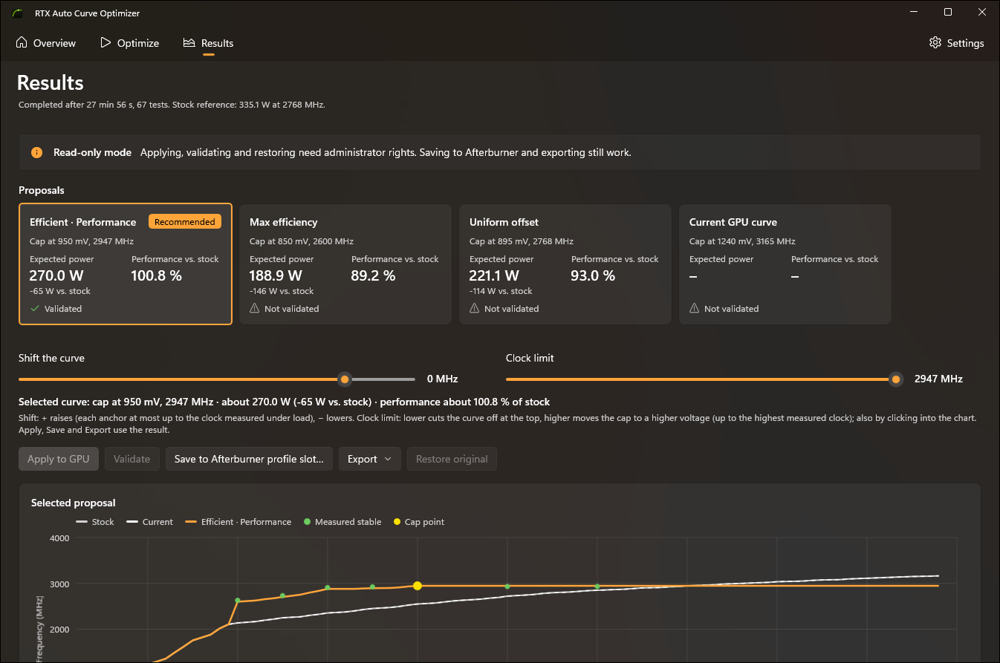
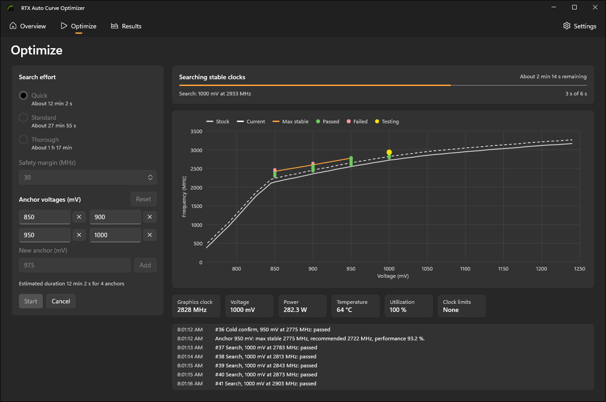

# RTX Auto Curve Optimizer

Automatic, stress-tested undervolting for NVIDIA RTX GPUs. The tool searches the voltage/frequency (V/F)
curve of your card for the highest stable clock at a set of voltages, measures power and performance, and
proposes a curve that keeps stock performance at lower voltage and power. Apply it directly or save it into
an MSI Afterburner profile slot.

The manual way – dragging points in Afterburner's curve editor, running a benchmark, crashing, repeating –
takes hours. This tool does the same search on its own, with a stress test that catches computation errors
within milliseconds, and protects your system while it pushes the card to its limit.

    



## Features

- **Automatic search per anchor voltage** (Quick: 4 anchors, Standard: 7, Thorough: 11). Each anchor starts at a
  clock that is already proven stable and climbs in 30 MHz steps, then narrows down to 15 MHz and confirms the
  result with a longer run under steady and pulsed load.
- **Cold confirm.** A hot GPU runs below its curve (thermal clock bins), so the tests above only prove the clock
  it actually ran. After a cool-down, short bursts run the full curve value on the cold GPU; the highest clock that
  ran error-free becomes the proven clock. Curves never go above a proven clock, so a cold game start does not hit
  untested territory.
- **Built-in DirectX 12 compute stress test.** Every result is compared on the GPU against a reference computed
  at stock settings, so silent computation errors end a test immediately – usually long before the driver would
  crash.
- **Proposals** built from the measurements:
  - **Efficient** (recommended): the lowest voltage that still reaches stock performance – same speed, less power.
  - **Max efficiency**: best performance per watt.
  - **Performance**: highest measured performance.
  - **Uniform offset**: the common manual method – one offset for the whole curve, flat from where it reaches the
    stock boost clock. The offset is the smallest one measured below that clock.
  The recommended proposal is validated as a whole curve under a variable load; any other one can be validated on
  request.
- **Fine-tuning on the results page**: shift the selected curve (raising stops at each anchor's proven clock) and
  set its top clock – lower cuts the curve off, higher moves the cap to a higher anchor. A live line shows the cap,
  power and performance of the curve as adjusted.
- **Apply to GPU**, **Restore original**, **Export** (JSON/CSV) and **Save to an MSI Afterburner profile slot**
  (with a backup of the profile file).
- **Safety net** for the moments when the card does crash – see [Safety](#safety).
- Windows 11 look (WinUI 3, Mica, light/dark). English and German UI, chosen from the system language.
- **Demo mode** with a simulated GPU: try the whole workflow without touching the hardware.
- A command line tool, `rtxaco`, for diagnostics, scripted runs and a curve write self-test.

## Screenshots

A run in demo mode: tested points (green = passed, red = failed), live telemetry and the log:



Results of a real Standard run on a GeForce RTX 5080: proposals, the curve controls, and the selected curve
against stock, the current curve and the proven clocks:


## How it works

1. The tool reads the stock curve and your current offsets from the driver, using the same driver functions as
   MSI Afterburner's curve editor.
2. It calibrates the stress test at stock settings, warms the card up, and measures two references: stock and
   your current curve.
3. For each anchor voltage it applies a **flat test curve**: the curve is lifted to the test clock at the anchor
   and flattened above it, so under load the GPU runs exactly at that voltage. The operating point is checked by
   the measured voltage; the normal thermal clock reduction under load is expected and allowed.
4. A test passes if the stress test finds no computation error and the driver does not reset. Under load a warm GPU
   runs below the curve value, so only the clock it **actually ran** counts as proven – from the confirm test, or
   higher from a cold burst (see Cold confirm). The proven clock minus a safety margin (default 30 MHz) becomes the
   recommended clock of the anchor.
5. The final curve keeps the measured headroom over stock between anchors and is flat above the chosen cap, so the
   GPU never runs at a higher voltage than the cap.

## Safety

Undervolting cannot damage the card – the tool never raises voltage. But finding the limit means crossing it, and
an unstable clock can crash the driver or, rarely, freeze the whole PC. The tool is built for that:

- **Never above a known failure.** A clock offset that failed at a lower voltage is never tested at a higher one,
  and every search starts at a clock that was already stable at a lower voltage. From there it climbs in 30 MHz
  steps, so a failing test is at most one step above the last clock that passed.
- **Every curve write is read back.** If the driver did not take the curve, the tool reconnects and checks again,
  or stops.
- **After a driver reset (TDR)** the tool waits, reopens all driver handles, sets the stock curve, verifies it and
  checks that telemetry works again before it continues. A test without telemetry is never judged.
- **Watchdog.** A second process watches the app. If the app crashes, it is restarted after 15 seconds and the run
  continues on its own. If the run makes no progress for 90 seconds, the app is terminated and restarted. After
  three restarts the watchdog stops.
- **Crash recovery.** The state is saved before every test. If the PC had to be restarted, start the app again: it
  restores your original curve, records the test that was running as a failure, and offers to resume.
- Your **power limit, fans and memory overclock are not touched**. Offsets applied by the tool do not survive a
  reboot; only a saved Afterburner profile makes a curve permanent.

## Supported GPUs

| GPU | Status |
|---|---|
| GeForce RTX 50 (Blackwell) | Tested on an RTX 5080 (driver 621.01) |
| GeForce RTX 40 / 30 / 20, GTX 16 | Expected to work (same driver interface as Afterburner's curve editor), untested |
| GeForce GTX 10 (Pascal) | Probably works, untested |
| Older NVIDIA, AMD, Intel | Not supported |
| Laptop GPUs | Unknown – some vendors lock curve changes |

If the driver refuses to read or write the curve, the tool reports it and changes nothing.

## Install

Download the zip from the [latest release](../../releases/latest), unpack it and run
`RtxAutoCurveOptimizer.App.exe`. It asks for administrator rights (writing the curve needs them). No .NET runtime
is needed; everything is included.

## Use

1. **Close games and MSI Afterburner** (Afterburner re-applies its own profile and rewrites its profile files when
   it exits) and save your work in other programs.
2. Optional: in an elevated terminal, run `rtxaco write-test`. It writes your current curve, the curve minus
   15 MHz and your original curve again, and reads each one back. No GPU load.
3. **Optimize page:** choose the search effort, keep the safety margin at 30 MHz (raise it if games crash later),
   and press **Start**. Rough durations: Quick ≈ 12 min, Standard ≈ 28 min, Thorough ≈ 1 h 20 min; more when the
   card resets often. Short black screens are expected.
4. **Results page:** pick a proposal (Efficient is recommended) and click **Apply to GPU**. Play your games for a
   while. If they run stable, click **Save to Afterburner profile slot…**, open Afterburner, load that slot and
   check the curve in its curve editor (Ctrl+F) before you enable it at startup.
5. **Restore original** writes back the curve you had before the optimization.

Demo mode: Settings page, or start the app with `--simulate`.

## Command line (`rtxaco`)

| Command | Admin | GPU load | Purpose |
|---|---|---|---|
| `info [--json]` | no | no | GPU, curve, offsets, telemetry, Afterburner state |
| `stress --seconds N [--pattern steady\|pulsed\|variable]` | no | yes | Stress test only; never changes the curve |
| `simulate [--preset quick\|standard\|thorough]` | no | no | Whole optimization on a simulated GPU |
| `run [--preset …] [--margin MHz] [--force]` | yes | yes | Real optimization; Ctrl+C cancels and restores |
| `write-test` | yes | no | Proves that curve writes work |
| `apply <session> [--proposal …]`, `restore <session>`, `reset` | yes | no | Apply a proposal, restore the original curve, or zero all offsets |
| `export <session> --proposal … [--format csv\|json]` | no | no | Write a proposal's curve |
| `afterburner <session> --proposal … --slot 1..5` | yes | no | Write a proposal into an Afterburner slot |

Exit codes: 0 ok, 1 failure, 2 administrator needed, 3 usage error, 130 cancelled.

## What is stored and sent where

Nothing is sent anywhere; the tool makes no network connections. Runs are saved as JSON in
`%LOCALAPPDATA%\RtxAutoCurveOptimizer\sessions`, together with a crash log and the watchdog's heartbeat and log.

## Limits

- **Tested on one GPU** (RTX 5080). Other cards are expected to work but are untested.
- **A passing stress test is strong evidence, not a guarantee.** Games use parts of the GPU the compute stress test
  does not load (raster, ray tracing, tensor cores, video). Test a new curve in your games before you make it
  permanent, and raise the safety margin if they crash.
- A **hard freeze of the whole PC** cannot be caught by any software; it needs a restart. The tool keeps the risk
  low and resumes afterwards.
- The Afterburner profile format (`VFCurve`) is reverse-engineered. Always check a saved slot in Afterburner's curve
  editor.

## Troubleshooting

| Symptom | Cause / fix |
|---|---|
| "Read-only mode" | The app was started without administrator rights. |
| "MSI Afterburner is running" | Close Afterburner before optimizing or saving a profile. |
| Black screen for a few seconds during a run | A driver reset at an unstable clock – expected; the run continues. |
| "The GPU stopped responding" | The driver did not recover. Restart the PC, start the app and resume. |
| A curve crashes in a game | Increase the safety margin, or pick a proposal with a lower cap. **Restore original** brings back your old curve. |

## Development

Requires the .NET 10 SDK on Windows (no Visual Studio needed).

```powershell
dotnet build RtxAutoCurveOptimizer.slnx
dotnet test RtxAutoCurveOptimizer.slnx --filter "Category!=Gpu"
```

The `Gpu` tests run the stress test on a real NVIDIA GPU. The optimizer is tested against a simulated GPU with
virtual time (driver resets, stale handles, thermal clock reduction, power limits), so a full run takes
milliseconds. For UI work without UAC prompts, build with `-p:DevAsInvoker=true` and start with `--simulate`.

Projects: `Core` (contracts), `Hardware` (NVAPI/NVML), `Stress` (DirectX 12 compute via ComputeSharp),
`Optimization` (search, curves, sessions, watchdog policy, simulation), `Afterburner` (profile format), `App`
(WinUI 3), `Cli`. The app icon is generated by `tools/app-icon/make_icon.py`.

## Disclaimer

Not affiliated with NVIDIA or MSI. NVIDIA, GeForce and RTX are trademarks of NVIDIA Corporation; MSI Afterburner
is a product of Micro-Star International. Use at your own risk.

## License

[MIT](LICENSE)
